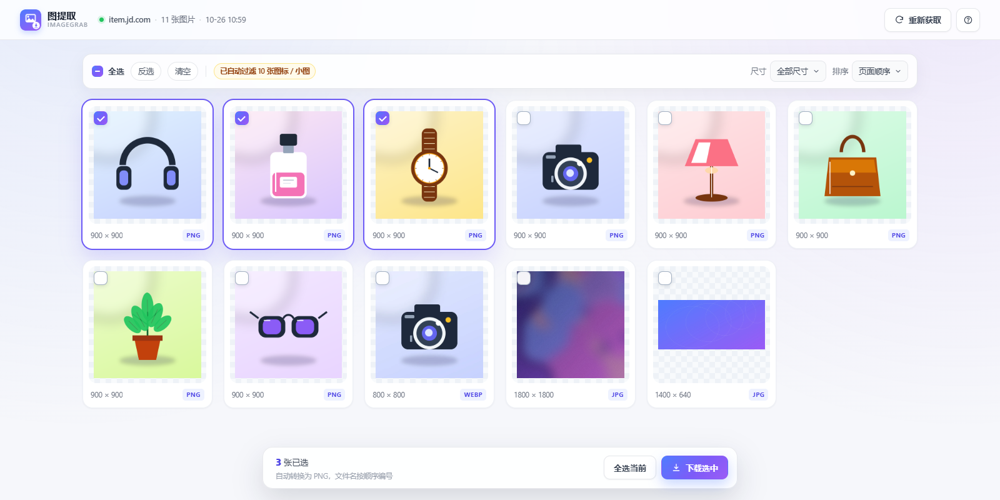
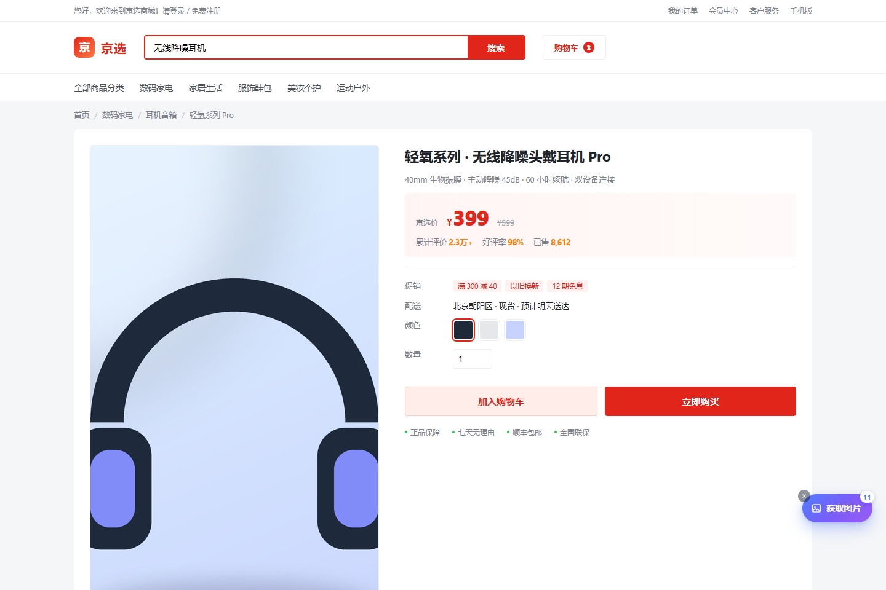

# 图提取 ImageGrab

一款基于 Manifest V3 的 Edge / Chrome 浏览器扩展：在淘宝、天猫、京东、拼多多商品详情页一键提取所有图片，集中预览、自由勾选，批量下载为统一格式的 PNG。



## 核心功能

- **一键提取**：扫描 `img`、`srcset`、`data-src` 等懒加载属性、`background-image`、JSON-LD 与 `og:image`。
- **智能过滤**：排除图标、logo、头像、占位图、1×1 像素图，以及短边小于 100px 的小图；自动去重、补全相对路径。
- **集中预览**：新标签页响应式网格，显示真实尺寸与原始格式，支持单张放大、左右切换。
- **自由勾选**：全选 / 反选 / 清空 / 按尺寸筛选 / 按大图排序，支持 `Ctrl / ⌘ + A`。
- **统一 PNG**：JPG、WebP、GIF 等在后台通过 OffscreenCanvas 转为 PNG，保留透明通道与原始分辨率。
- **批量下载**：逐张显示进度、成功与失败反馈，文件名自动编号为 `商品图_001.png`。

| 详情页悬浮按钮 | 图片画廊 |
| --- | --- |
|  |  |

## 支持平台

| 平台 | 详情页示例 |
| --- | --- |
| 淘宝 | `item.taobao.com/item.htm?id=...` |
| 天猫 | `detail.tmall.com/item.htm?id=...` |
| 京东 | `item.jd.com/100012043978.html` |
| 拼多多 | `mobile.yangkeduo.com/goods.html?goods_id=...` |

任意其他网页也可以点击工具栏的「图提取」图标手动触发一次提取（受浏览器跨域限制时，图片会按原格式兜底下载）。

## 安装（Edge）

1. 下载 [`docs/downloads/ImageGrab-v1.0.0.zip`](docs/downloads/ImageGrab-v1.0.0.zip) 并解压到本地文件夹（确保第一层有 `manifest.json`）。
2. 打开 `edge://extensions`，开启「开发人员模式」。
3. 点击「加载解压缩的扩展」，选择解压后的文件夹。
4. 打开商品详情页，点击右下角「获取图片」。

Chrome 步骤相同，地址改为 `chrome://extensions`。详细说明见 [`INSTALL.txt`](INSTALL.txt)。

## 项目结构

```text
ImageGrab/
├── manifest.json            # MV3 清单：权限、注入规则、图标
├── background.js            # Service Worker：扫描存储、下载、PNG 转换、消息路由
├── content.js               # 详情页悬浮按钮、扫描触发、页面路由监听
├── content.css              # 悬浮按钮 / Toast 样式
├── lib/
│   └── extract-core.js      # 纯函数提取核心（可单测）
├── gallery.html/css/js      # 图片画廊：勾选、筛选、预览、批量下载
├── icons/                   # 16/32/48/128 图标
├── docs/                    # 纯静态官网 + 可下载 ZIP
│   ├── index.html
│   ├── css/style.css
│   ├── js/main.js
│   ├── assets/              # 截图、Logo、favicon
│   └── downloads/           # 打包后的插件 ZIP
├── scripts/
│   ├── package.ps1          # 一键打包 ZIP
│   └── make-icons.py        # 生成图标
├── tests/                   # 单测 + Playwright 端到端测试
└── .github/workflows/pages.yml
```

## 本地开发

没有构建步骤，修改源码后直接在 `edge://extensions` 点击扩展卡片上的「重新加载」即可。

### 测试

要求：本机安装 Microsoft Edge；Node.js 18+。

```bash
cd tests
npm install

npm run test:unit         # 纯函数单测（29 项）
npm run test:e2e          # Edge 端到端：提取 → 画廊 → 真实下载 PNG
npm run test:e2e:product  # 真实 manifest：模拟 item.jd.com 自动注入按钮
```

`test:e2e` 会启动本机 Edge、加载扩展、在本地模拟详情页中提取 11 张图片、勾选全部并校验下载文件的 PNG 签名与尺寸（含 1800×1800 大图），同时产出官网截图到 `docs/assets/`。

### 打包

```powershell
powershell -ExecutionPolicy Bypass -File scripts/package.ps1
```

产物：`docs/downloads/ImageGrab-v1.0.0.zip`，`manifest.json` 位于压缩包根目录。

### 预览官网

直接双击 `docs/index.html`，或：

```bash
python -m http.server 8080 -d docs
```

然后访问 <http://localhost:8080>。

## 权限说明

| 权限 | 用途 |
| --- | --- |
| `activeTab` | 点击工具栏图标时临时访问当前页面 |
| `scripting` | 在非受支持页面手动注入提取按钮 |
| `downloads` | 保存转换后的 PNG |
| `storage` | 暂存最近 5 次扫描结果（`storage.session`） |
| `host_permissions` | 读取 5 个平台的页面与图片 CDN，用于 PNG 转换 |

所有提取、转码、下载都在本地浏览器完成，不包含任何远程上报逻辑，也不会收集浏览记录。源站 CDN 若限制跨域读取像素，插件会退回下载原始格式并在界面提示，不会生成打不开的假 PNG。

## 已知限制

- 不扫描跨域 iframe 和 Closed Shadow DOM 内的图片。
- 电商平台改版后，若新增懒加载属性或详情页 URL 规则，需要同步更新 `lib/extract-core.js` 与 `content.js`。
- 极少数图片源站会校验防盗链，可能只能下载原格式。
- 需要登录 / 验证码才能看到的图片，扩展无法绕过。

## 开源协议

[MIT](LICENSE) © 2026 ImageGrab Contributors

> 演示页中的商品图与「京选商城」页面均为本地生成的测试素材，仅用于功能展示，不涉及真实商品。
